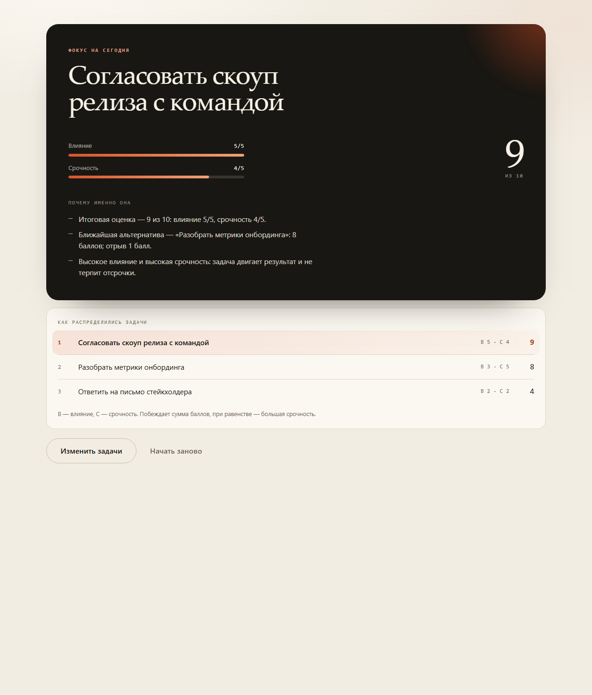

# FocusDesk

[](https://github.com/Renown134/focusdesk/actions/workflows/tests.yml)

Приложение для продакт-менеджера, которое помогает выбрать **одну** задачу на рабочий день.
Пользователь вводит ровно три задачи, оценивает каждую по влиянию и срочности — и получает
карточку фокуса с коротким объяснением, почему выбрана именно она.



**Демо:** https://renown134.github.io/focusdesk/

## Как это работает

1. Введите три задачи — ровно столько, сколько реально можно удержать в голове.
2. Для каждой отметьте **влияние** и **срочность** по шкале от 1 до 5.
3. Нажмите «Выбрать фокус» и получите одну карточку: задачу, её оценку и объяснение выбора.

Данные живут только в текущей вкладке: ни localStorage, ни сервера, ни аккаунта.

## Правила выбора

| Шаг | Правило |
| --- | --- |
| 1 | Итоговая оценка задачи = влияние + срочность (от 2 до 10). |
| 2 | При равной сумме выше стоит задача с большей срочностью. |
| 3 | Если совпали и сумма, и срочность — побеждает задача, введённая раньше. |

Пример: «Согласовать скоуп релиза» (влияние 5, срочность 4) даёт 9 баллов и опережает
«Разобрать метрики онбординга» (3 + 5 = 8) и «Ответить на письмо стейкхолдера» (2 + 2 = 4).

Объяснение в карточке собирается из этих же правил: оно называет итоговый балл, отрыв от
ближайшей альтернативы (или сработавший тай-брейк) и профиль задачи — например, «высокое
влияние и высокая срочность».

## Запуск

Приложению нужен только статический сервер: ES-модули не работают из `file://`.

```bash
node server.mjs
# FocusDesk: http://127.0.0.1:5173
```

Либо любой другой статический сервер:

```bash
python -m http.server 5173
```

## Тесты

```bash
npm test
```

10 тестов на `node:test` проверяют сумму баллов, ранжирование, оба тай-брейка, тексты
объяснений и валидацию формы. Зависимостей нет.

## Структура

```
index.html            разметка страницы
assets/styles.css     оформление и адаптив
assets/app.js         состояние формы, валидация, рендер результата
assets/scoring.js     чистые функции выбора фокуса (используются тестами)
server.mjs            локальный статический сервер без зависимостей
tests/                тесты логики
docs/PRD.md           продуктовая спецификация
docs/SPEC.md          техническая спецификация и контракты
docs/DECISIONS.md     принятые решения и их обоснование
AGENTS.md             правила для агентов и контрибьюторов
PLAN.md               статус и план развития
```

## Границы кейса

- один пользователь — продакт-менеджер;
- один сценарий — три задачи и одна карточка фокуса;
- данные существуют только в текущей сессии;
- вне кейса: календарь, трекер задач, авторизация, реальные рабочие данные, генерация кода.

## Документация

- [PRD: требования, правила и критерии приёмки](docs/PRD.md)
- [SPEC: архитектура, алгоритмы, DOM-контракт, сервер](docs/SPEC.md)
- [Решения и компромиссы](docs/DECISIONS.md)
- [План: что сделано и что дальше](PLAN.md)
- [AGENTS.md: правила работы с кодом](AGENTS.md)

## Лицензия

MIT
